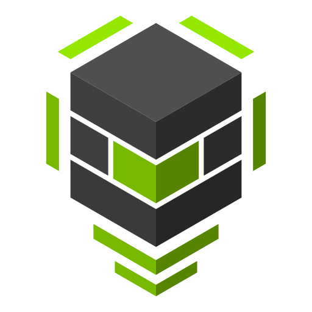

<div align="center">



# go-dcgm

**Go bindings for NVIDIA Data Center GPU Manager (DCGM).**

<a href="https://pkg.go.dev/github.com/NVIDIA/go-dcgm/pkg/dcgm">API reference</a>
·
<a href="samples/README.md">Samples</a>
·
<a href="https://docs.nvidia.com/datacenter/dcgm/latest/user-guide/index.html">DCGM user guide</a>
·
<a href="CONTRIBUTING.md">Contribute</a>

<p>
  <a href="https://github.com/NVIDIA/go-dcgm/actions/workflows/go.yml"></a>
  <a href="https://app.codecov.io/gh/NVIDIA/go-dcgm"></a>
  <a href="https://github.com/NVIDIA/go-dcgm/releases"></a>
  <a href="https://pkg.go.dev/github.com/NVIDIA/go-dcgm"></a>
  <a href="LICENSE"></a>
  <a href="CONTRIBUTING.md#sign-your-work"></a>
</p>

</div>

---

## Overview

go-dcgm provides Go bindings for [NVIDIA Data Center GPU Manager
(DCGM)](https://developer.nvidia.com/dcgm). DCGM manages and monitors NVIDIA
GPUs in cluster environments. [DCGM
Exporter](https://github.com/NVIDIA/dcgm-exporter) uses these bindings to
publish GPU telemetry to Prometheus.

This repository contains the `pkg/dcgm` package, sample programs, and the
field-constant generator.

## Requirements

- Linux with an NVIDIA GPU and driver supported by DCGM. See the [DCGM support
  matrix](https://docs.nvidia.com/datacenter/dcgm/latest/user-guide/getting-started.html#supported-platforms).
- DCGM 4 installed on the host. The bindings load `libdcgm.so.4` at runtime.
- cgo enabled when building.

Connection strings in standalone mode require DCGM 4.5.0 or later.

## Usage

```bash
go get github.com/NVIDIA/go-dcgm
```

```go
cleanup, err := dcgm.Init(dcgm.Embedded)
if err != nil {
    log.Fatal(err)
}
defer cleanup()

gpus, err := dcgm.GetSupportedDevices()
if err != nil {
    log.Fatal(err)
}

for _, gpu := range gpus {
    info, err := dcgm.GetDeviceInfo(gpu)
    if err != nil {
        log.Fatal(err)
    }
    fmt.Printf("GPU %d: %s (%s)\n", gpu, info.Identifiers.Model, info.UUID)
}
```

`dcgm.Init` supports three modes:

- `Embedded` runs the DCGM host engine inside your process.
- `Standalone` connects to a running `nv-hostengine` over TCP or a Unix socket.
- `StartHostengine` starts `nv-hostengine` as a child process and stops it on
  cleanup.

See the [samples](samples/README.md) for complete programs, including device
information, health checks, policies, diagnostics, and a REST API.

### Diagnostics

`RunDiag` returns hierarchical `DiagResults`. New code should use
`results.Tests`; each test includes its status, per-entity results, errors,
information, and extra data. `DiagResults.Software` and `DiagResult` remain
available as a deprecated compatibility view. See the [diagnostic
sample](samples/diag/main.go).

## Development

The repository uses Task for common commands and Bazel for Go and cgo builds.
See [CONTRIBUTING.md](CONTRIBUTING.md) for the pinned tool versions, or open the
repository in a [Dev Containers](https://containers.dev/) compatible editor to
use the same environment as CI.

These checks do not need a GPU:

```bash
task build
task test
task validate
```

These need a GPU host with DCGM installed:

```bash
task test:integration
task test:race
```

After updating `pkg/dcgm/dcgm_fields.h`, regenerate the field constants with
`task generate` and confirm them with `task generate:check`. See [Updating DCGM
Fields](CONTRIBUTING.md#updating-dcgm-fields) for the full process.

## Contributing and support

Read [CONTRIBUTING.md](CONTRIBUTING.md) before submitting a change. For
community support, [open an issue](https://github.com/NVIDIA/go-dcgm/issues/new).

Report potential security vulnerabilities through the
[NVIDIA Product Security](https://www.nvidia.com/en-us/security/) process, not
through a public issue.

## License

go-dcgm is licensed under the [Apache License, Version 2.0](LICENSE).
